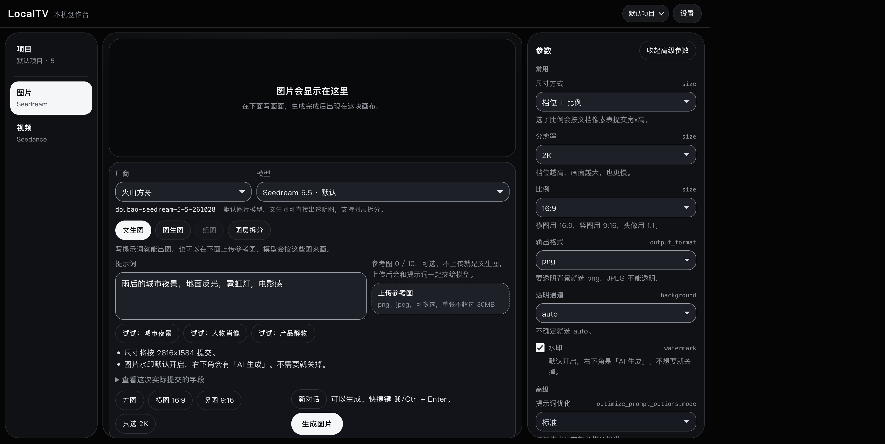
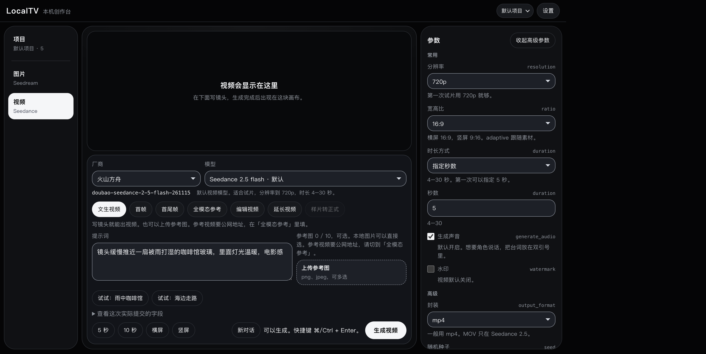
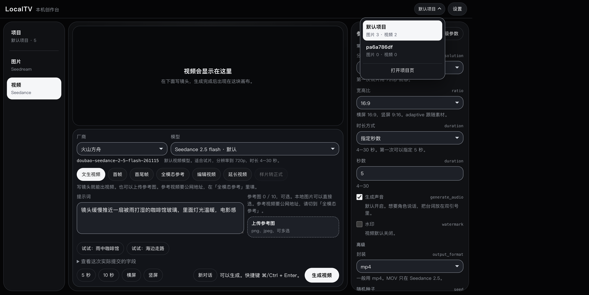

# LocalTV

跑在你自己电脑上的创作页。浏览器里选模型、填参数，用你自己的火山方舟 API Key 调用 Seedream 生图、Seedance 生视频。计算在方舟完成，提示词、参考图和成片留在本机。

没有 LocalTV 账号，页面也不做登录。费用走你的方舟账户，每次生成都会扣额度。密钥不进项目目录，页面上只显示末尾四位。

当前版本 `0.1.0`。能直接生成的只有火山方舟。MiniMax 和可灵可以先把密钥存下来，模型还没接入，页面上会标「即将接入」。这一版没有命令行、Agent Skill 和参数预设。

## 界面

左侧切换图片和视频，中间写提示词，右侧是当前模型的参数。灰色的项是这个模型用不了的。



视频页同样先选任务，再写镜头。时长、声音和水印都在右侧。



右上角点项目名就能切换当前项目。左侧「项目」用来浏览成片和新建项目。



## 环境

- Python 3.10 或更高
- 能访问火山方舟的网络
- 一个浏览器

页面默认只监听本机：http://127.0.0.1:8787 。不要把 `LOCALTV_HOST` 改成 `0.0.0.0` 后再暴露到公网。密钥和成片都在这台电脑上。

「选择文件夹」「打开图片」「打开视频」「在访达中显示」是 macOS 上的行为：图片用预览打开，视频用 QuickTime 打开。其他系统请到成片目录里自己打开文件，存储位置在设置里填写绝对路径。

## 启动

在项目目录执行：

```bash
./start.sh
```

Windows 双击 `start.bat`，或在项目目录执行它。第一次会创建 `.venv` 并安装依赖，之后再运行就是直接启动。macOS 上脚本会打开浏览器。关掉这个窗口，页面就停。不想自动打开浏览器时：

```bash
LOCALTV_NO_OPEN=1 ./start.sh
```

也可以自己装：

```bash
python3 -m venv .venv
source .venv/bin/activate
pip install -r requirements.txt
python -m localtv
```

Windows 激活虚拟环境用 `.venv\Scripts\activate`。换地址或端口：

```bash
LOCALTV_HOST=127.0.0.1 LOCALTV_PORT=8787 python -m localtv
```

## 第一次使用

1. 在[火山方舟控制台](https://console.volcengine.com/ark)创建 API Key，并确认要用的 Seedream、Seedance 模型已经开通。
2. 打开页面，点右上角「设置」，在「火山方舟」里粘贴 Key。
3. 接口保持默认：`https://ark.cn-beijing.volces.com/api/v3`。只填到 `/api/v3`，不要填具体的图片或视频接口。
4. 保存。页面上只会显示密钥末尾四位。
5. 回到「图片」或「视频」，写提示词，点生成。没有 Key 时，生成按钮不可用。

密钥写在 `~/.localtv/config.toml`，文件权限是 `0600`（只有当前用户可读写）。不要把这个文件提交到 git，也不要贴到 Issue 里。留空再保存不会清掉已经存好的 Key。要清除某一家的密钥，用设置里对应的清除按钮。

环境变量会盖过文件里的对应密钥：

| 服务商 | 环境变量 | 默认接口 | 现在能不能生成 |
| --- | --- | --- | --- |
| 火山方舟 | `ARK_API_KEY` | `https://ark.cn-beijing.volces.com/api/v3` | 可以 |
| MiniMax | `MINIMAX_API_KEY` | `https://api.minimaxi.com`（国际密钥用 `https://api.minimax.io`） | 还不能，只保存密钥 |
| 可灵 | `KLING_API_KEY` | `https://api-beijing.klingai.com`（海外用 `https://api-singapore.klingai.com`） | 还不能，只保存密钥 |

可灵新版控制台填 API Key；旧版开放平台填 Access Key 和 Secret Key。三家密钥各自保存，互不影响。选到还没有模型的厂商时，生成按钮不可用。

## 页面

左侧三个入口：

| 入口 | 做什么 |
| --- | --- |
| 项目 | 浏览这个项目里的图片和视频，新建项目 |
| 图片 | Seedream 生图 |
| 视频 | Seedance 生视频 |

右上角点项目名可以直接切换当前项目。

中间上面是画布，生成结果出现在这里。下面是生成器：先选厂商和模型，再选任务，然后写提示词、加参考素材。右侧是参数，常用在上，高级在下。生成器底部可以展开「查看这次实际提交的字段」。

`⌘/Ctrl + Enter` 触发生成。「新对话」只清空当前这一侧的提示词、参考素材和画布，模型和参数留着。已经生成的文件还在项目里。

灰色的任务或参数是当前模型不支持的，旁边有原因。即将下线的模型名称上会标明。换模型后，新模型不接受的值会回到该模型的默认，不会偷偷拿旧值去提交。

## 参数怎么提交

页面把该模型公开的参数都列出来。

- 模型和支持的任务一定会发。
- 和官方默认值相同的字段不发。
- 你改过的字段按页面上的值发，包括改成关闭。
- 当前模型不支持的字段留在页面上，但是禁用，不会丢掉你填过的值。
- 非法组合在点击前拦住，例如 JPEG 加透明通道、组图加图层拆分、首帧和全模态混用。

所以「查看这次实际提交的字段」里通常比右侧表单短。这是预期行为。摘要里不会出现 API Key。

## 生图

默认模型是 Seedream 5.5。图片水印默认开启，成片右下角会有「AI 生成」，不想要就在右侧关掉。

| 任务 | 怎么用 |
| --- | --- |
| 文生图 | 只写提示词。也可以再上传参考图，模型会一起看 |
| 图生图 | 先上传要改的图，提示词写改什么、留什么 |
| 组图 | 一次出一组相关图。目前只有 Seedream 5.0 lite、4.5、4.0 可以选 |
| 图层拆分 | 把一张 png 或 jpeg 拆成图层。5.5、5.0 pro、5.0 flash 可用 |

参考图可选本机文件，单张不超过 30MB。图层拆分只接受一张 png 或 jpeg。5.5 的文生图可以直接出透明图。5.0 pro 和 5.0 flash 要出透明图时，参考图本身必须带透明通道。透明通道和 JPEG 不能同时选。

常用尺寸在生成器底部：方图、横图 16:9、竖图 9:16、只选 2K。选了比例时，LocalTV 按该模型文档里的像素表提交宽高。生成完成后，画布上可以打开图片、在访达中显示，或「接着做视频」。接着做视频会把这张图带进视频页的参考素材。

| 模型 | Model ID | 说明 |
| --- | --- | --- |
| Seedream 5.5 | `doubao-seedream-5-5-261028` | 默认。档位 1K / 1.5K / 2K，默认 2K。输出默认 png。最多 10 张参考图。可图层拆分 |
| Seedream 5.0 pro | `doubao-seedream-5-0-pro-260628` | 可选快速提示词优化。输出默认 jpeg。最多 10 张参考图 |
| Seedream 5.0 flash | `doubao-seedream-5-0-flash-260915` | 速度更快。输出默认 jpeg。最多 10 张参考图 |
| Seedream 5.0 lite | `doubao-seedream-5-0-260128` | 即将下线。组图、流式输出和联网搜索只在这一档。档位 2K / 3K / 4K。最多 14 张参考图 |
| Seedream 4.5 | `doubao-seedream-4-5-251128` | 即将下线。组图和流式输出。只出 JPEG。档位 2K / 4K |
| Seedream 4.0 | `doubao-seedream-4-0-250828` | 即将下线。组图、流式输出和快速提示词优化。只出 JPEG。档位 1K / 2K / 4K |

图片参数和方舟字段的对应关系：

| 页面项 | 方舟字段 | 说明 |
| --- | --- | --- |
| 模型 | `model` | 上表。高级里可以另填接入点 ID，参数约束仍按所选模型 |
| 提示词 | `prompt` | 始终可见 |
| 参考图 | `image` | 本地文件。5.5 / 5.0 pro / flash 最多 10 张，5.0 lite / 4.5 / 4.0 最多 14 张 |
| 尺寸方式 | `size` | 只选档位、档位加比例，或自定义宽高。后两种提交 `宽x高` |
| 分辨率档位 | `size` | 随模型变化，见上表 |
| 比例 | `size` | `1:1`、`4:3`、`3:4`、`16:9`、`9:16`、`3:2`、`2:3`、`21:9`。与「只选档位」互斥 |
| 自定义宽高 | `size` | 5.5 / 5.0 pro / flash 总像素 921600–4624220。5.0 lite / 4.5 为 3686400–16777216。4.0 为 921600–16777216。宽高比都要在 1/16 到 16 |
| 输出格式 | `output_format` | `png` 或 `jpeg`。4.5 / 4.0 只有 JPEG，此项禁用 |
| 透明通道 | `background` | `auto`、`transparent`、`opaque`。5.5 默认 `auto`。图层拆分时禁用 |
| 提示词优化 | `optimize_prompt_options.mode` | 默认 `standard`。`fast` 只在 5.0 pro 和 4.0 |
| 水印 | `watermark` | 默认开启 |
| 返回方式 | `response_format` | `url` 或 `b64_json`，默认 `url`。两种都会再存成本地文件 |
| 组图 | `sequential_image_generation` | 默认关闭。只在 5.0 lite、4.5、4.0 |
| 组图张数上限 | `sequential_image_generation_options.max_images` | 1–15，默认 15。参考图张数加生成张数不超过 15 |
| 流式返回 | `stream` | 默认关闭。只在 5.0 lite、4.5、4.0 |
| 联网搜索 | `tools` 里的 `web_search` | 只在 5.0 lite |
| 图层拆分 | `layer_decomposition` | 打开后只允许一张输入图 |
| 拆分张数上限 | `layer_decomposition_options.max_images` | 2–100，默认 30，含底图。只在 5.5 |
| 文字识别 | `layer_decomposition_options.text_recognition` | 默认关闭。只在 5.5，且拆分打开时 |
| 终端用户标识 | `safety_identifier` | 可选，不超过 64 个英文字符。5.5、5.0 pro、5.0 flash |

接口是 `POST /images/generations`。

## 生视频

默认模型是 Seedance 2.5 flash，分辨率到 720p，时长 4–30 秒。要更高分辨率用 Seedance 2.5。视频水印默认关闭。声音默认生成；想让角色说话，把台词放在双引号里。第一次试片用 720p、指定 5 秒或 10 秒即可。

视频是异步的。提交后页面会等方舟，完成后自动下载到当前项目。生成过程中不要关掉运行 LocalTV 的终端。

| 任务 | 怎么用 |
| --- | --- |
| 文生视频 | 写镜头。本地参考图可以直接选 |
| 首帧 | 上传第一帧图片 |
| 首尾帧 | 上传开始和结束两张图。1.0 pro fast 没有这项 |
| 全模态参考 | 图、视频、音频一起做参考。参考视频必须是公网地址，方舟读不到你电脑上的文件 |
| 编辑视频 | 在已有视频上改。需要参考视频的公网地址。比例锁成 `adaptive`，时长锁成让模型决定 |
| 延长视频 | 把视频往后接 |
| 样片转正式 | 只有 Seedance 2.5 标准版可以开样片模式。样片分辨率锁在 480p |

参考音频只接受 wav 或 mp3，单段不超过 15MB。2.0 系列不能只有音频。本地素材编码后的请求体大约不能超过 64MB，太大时改用公网 URL。1080p 和 4K 在部分模型上是 10bit H.265，需要用 VLC、MPV 或 QuickTime 播放。

| 模型 | Model ID | 说明 |
| --- | --- | --- |
| Seedance 2.5 flash | `doubao-seedance-2-5-flash-261115` | 默认。480p / 720p，4–30 秒。参考图最多 10 张，参考视频和音频各最多 5 条。可出 mp4 或 mov |
| Seedance 2.5 | `doubao-seedance-2-5-260628` | 480p / 720p / 1080p / 4K，4–30 秒。参考图最多 30 张，参考视频和音频各最多 10 条。只有这一档能开样片 |
| Seedance 2.0 | `doubao-seedance-2-0-260128` | 4–15 秒，最高 4K。参考图最多 9 张，参考视频和音频各最多 3 条 |
| Seedance 2.0 fast | `doubao-seedance-2-0-fast-260128` | 更快，分辨率到 720p，4–15 秒 |
| Seedance 2.0 mini | `doubao-seedance-2-0-mini-260615` | 更轻，分辨率到 720p，4–15 秒 |
| Seedance 1.0 pro | `doubao-seedance-1-0-pro-250528` | 即将下线。2–12 秒，默认 1080p。种子、帧数、固定镜头和离线推理只在 1.0 |
| Seedance 1.0 pro fast | `doubao-seedance-1-0-pro-fast-251015` | 即将下线。没有首尾帧 |

视频参数和方舟字段的对应关系：

| 页面项 | 方舟字段 | 说明 |
| --- | --- | --- |
| 模型 | `model` | 上表。高级里可以另填接入点 ID |
| 提示词 | `content` 里的文本 | 编辑任务必须带一条参考视频 |
| 首帧 / 尾帧 | `image_url` 加 `role` | 首帧 1 张；首尾帧 2 张，角色分别是 `first_frame`、`last_frame`。2.5 的首帧和首尾帧把比例锁成 `adaptive` |
| 参考图 | `role = reference_image` | 全模态。不能和首帧模式混用 |
| 参考视频 | `role = reference_video` | 必须是公网 URL。编辑、延长至少 1 条 |
| 参考音频 | `role = reference_audio` | wav 或 mp3 |
| 全模态意图 | `omni_reference_task_type` | `auto`、`reference`、`edit`、`extend`，默认 `auto`。2.5 和 2.0 的全模态任务 |
| 样片任务 | `draft_task.id` | 样片转正式时填写仍在有效期内的样片任务 ID |
| 分辨率 | `resolution` | 2.5 / 2.0 默认 `720p`。1.0 默认 `1080p`，没有 4K。样片模式锁 `480p` |
| 宽高比 | `ratio` | `16:9`、`4:3`、`1:1`、`3:4`、`9:16`、`21:9`、`adaptive`。2.5 / 2.0 默认 `adaptive`。1.0 文生视频默认 `16:9` |
| 时长 | `duration` | 整数秒，或 `-1` 表示让模型选。2.5 默认让模型选。编辑任务只能 `-1`。与帧数二选一 |
| 帧数 | `frames` | 29–289，且必须是 `25 + 4n`。只在 1.0 pro 和 1.0 pro fast。填写后优先于时长 |
| 生成声音 | `generate_audio` | 默认开启。2.5 和 2.0。1.0 禁用 |
| 水印 | `watermark` | 默认关闭 |
| 封装格式 | `output_format` | `mp4` 或 `mov`，默认 `mp4`。`mov` 只在 2.5 系列 |
| 随机种子 | `seed` | `-1` 到 2147483647，默认 `-1`。只在 1.0 |
| 固定镜头 | `camera_fixed` | 默认关闭。只在 1.0，参考图场景禁用 |
| 返回尾帧 | `return_last_frame` | 默认关闭。打开后尾帧 JPEG 会存到本地 |
| 样片模式 | `draft` | 默认关闭。打开后分辨率只能是 `480p`。只在 Seedance 2.5 标准版 |
| 服务等级 | `service_tier` | `default` 或 `flex`。`flex` 是离线推理，更便宜也更慢。只在 1.0 |
| 排队优先级 | `priority` | 0–9，默认 0。2.5 和 2.0。`flex` 下禁用 |
| 任务过期 | `execution_expires_after` | 3600–259200 秒，默认 172800（48 小时） |
| 回调地址 | `callback_url` | 可选。留空则只在本机轮询 |
| 联网搜索 | `tools` 里的 `web_search` | 2.5 和 2.0 |
| 终端用户标识 | `safety_identifier` | 可选，不超过 64 个英文字符 |

视频接口是异步的：先 `POST /contents/generations/tasks`，再 `GET /contents/generations/tasks/{id}` 轮询，成功后下载到本地。状态会显示排队中、生成中、成功、失败、超时或已过期。超时后任务 ID 还在，可以继续查、继续下载，不会为了同一次任务重新扣费。

## 成片放在哪

默认目录是文稿里的 `LocalTV`，也就是 `~/Documents/LocalTV/`。设置里可以改。改的时候，已有项目会一起搬过去。密钥仍留在 `~/.localtv/config.toml`，不会跟着成片走。

```text
~/Documents/LocalTV/
  default/
    project.json
    inputs/              这次任务用过的参考图
    jobs/                每条任务一条记录
    outputs/<任务 id>/   图片或 video.mp4
```

每条任务记录里有提示词、模型、实际提交的字段、输入文件、输出路径和方舟任务 ID。页面上的路径在文稿目录下时会显示成「文稿/…」。

左侧「项目」页按图片、视频分组。点「查看」回到对应的图片或视频页，把这条结果显示在画布上。点「在此项目中创作」把它设为当前项目，并回到创作页。

| 变量 | 作用 |
| --- | --- |
| `LOCALTV_HOST` | 监听地址，默认 `127.0.0.1` |
| `LOCALTV_PORT` | 端口，默认 `8787` |
| `LOCALTV_HOME` | 配置目录，默认 `~/.localtv` |
| `LOCALTV_LIBRARY` | 成片目录。设了之后，设置里不能再改存储位置，也不会自动搬家 |
| `LOCALTV_NO_OPEN` | 设为 `1` 时，macOS 启动脚本不打开浏览器 |
| `ARK_API_KEY` | 盖过文件里的火山方舟密钥 |
| `MINIMAX_API_KEY` | 盖过文件里的 MiniMax 密钥 |
| `KLING_API_KEY` | 盖过文件里的可灵密钥 |

## 常见问题

**生成按钮是灰的。** 当前厂商没有密钥，或提示词、参考素材还没满足任务要求。看生成器里的红字。没有接入模型的厂商也不能生成。

**提示密钥无效或余额不足。** 这是方舟账户的问题。检查 Key、账户额度和模型是否已开通。LocalTV 不会显示完整 Key。

**内容被审核拒绝。** 任务标为失败，并显示方舟返回的原因。LocalTV 不会改写提示词再试，也不会提供绕过审核的做法。

**参考视频传不上去。** 视频不能选本机文件，要填方舟能访问的公网 URL。图片可以选本地文件。

**成片不在我选的文件夹。** 看设置里的存储位置，以及有没有设置 `LOCALTV_LIBRARY`。页面上的路径在文稿目录下时会显示成「文稿/…」。

**打开视频进了别的播放器。** 在 macOS 上，页面里的「打开视频」指定 QuickTime。访达里双击仍走系统默认播放器。

**换了存储位置，旧文件还在不在。** 从设置里保存新位置时，已有项目会搬过去。只改 `LOCALTV_LIBRARY` 不会自动搬家。

**视频生成到一半终端关了。** 方舟上的任务还在。任务记录里留着远程任务 ID，重新打开页面后可以继续查和下载。

## 仓库里有什么

```text
start.sh / start.bat     创建虚拟环境、安装依赖、启动
localtv/__main__.py      入口
localtv/server.py        本机 HTTP 接口
localtv/catalog.py       模型、任务和参数
localtv/payload.py       按官方默认值决定哪些字段要发送
localtv/ark.py           调用火山方舟
localtv/store.py         配置、项目和成片
localtv/web/             页面
requirements.txt         FastAPI 和 uvicorn
```

模型名单会随方舟文档更新。已有任务记录仍保留当时实际使用的 Model ID。

- 图片生成 API：https://www.volcengine.com/docs/82379/1666945
- 视频生成任务 API：https://www.volcengine.com/docs/82379/1520757
